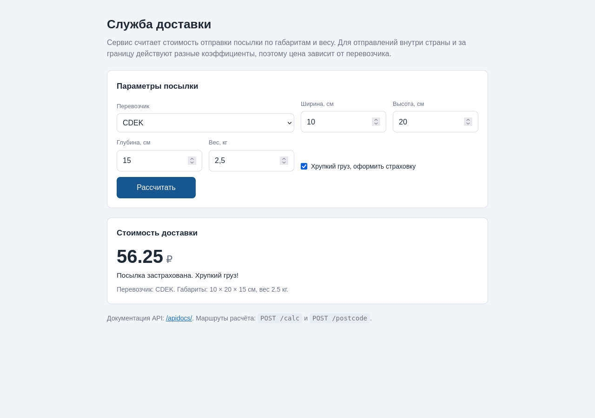
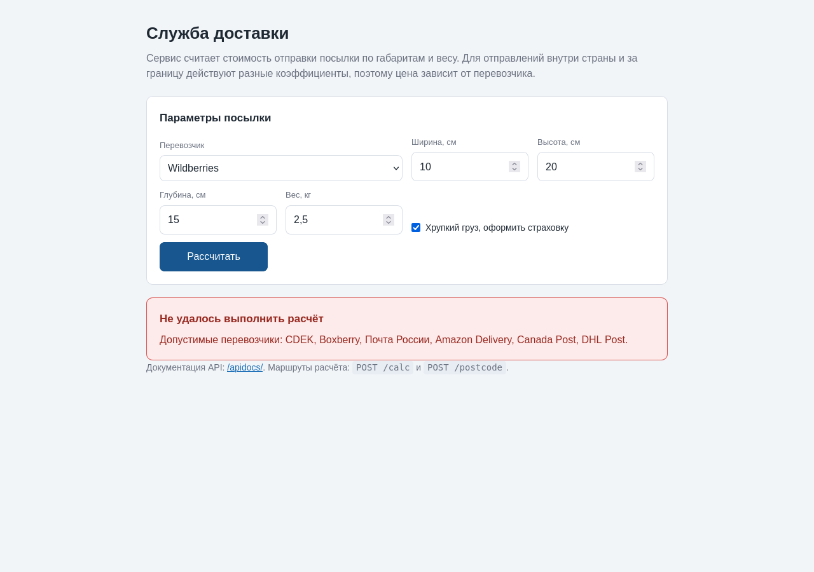
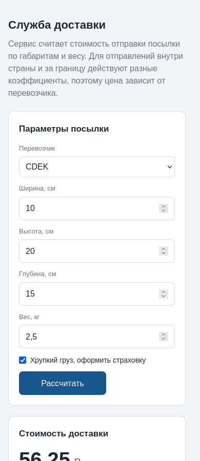

# Служба доставки

HTTP-сервис для службы доставки: считает стоимость посылки по габаритам и весу и
определяет почтовый индекс по адресу. Расчёт стоимости зависит от перевозчика, а
адрес разбирается по справочнику DaData.



## Что умеет

| Задача | Маршрут | Что возвращает |
| --- | --- | --- |
| Стоимость доставки | `POST /calc` | цену и текст о страховании посылки |
| Индекс по адресу | `POST /postcode` | полный адрес, район, город, улицу, индекс и часовой пояс |

Стоимость можно посчитать прямо на странице сервиса: есть форма с выбором перевозчика,
габаритами, весом и отметкой о страховании. Индекс по адресу определяется через API:
для этого маршрута нужен внешний сервис и его ключи.

| Расчёт стоимости на странице | Международный перевозчик |
| --- | --- |
|  |  |

| Отказ при неизвестном перевозчике | Узкий экран |
| --- | --- |
|  |  |

Перевозчики разделены на две группы, для каждой действует свой коэффициент:

| Группа | Перевозчики | Формула |
| --- | --- | --- |
| Внутри страны | CDEK, Boxberry, Почта России | `вес × (ширина + высота + глубина) / 2` |
| Международная | Amazon Delivery, Canada Post, DHL Post | `вес × (ширина + высота + глубина) × 1.333` |

Страхование приходит отдельным текстом: при `is_safe = true` посылка считается
хрупкой и застрахованной, иначе в страховке отказано.

Запрос стоимости:

```bash
curl -X POST http://127.0.0.1:9020/calc \
  -H 'Content-Type: application/json' \
  -d '{"type": "CDEK", "width": 10, "height": 20, "depth": 15, "weight": 2.5, "is_safe": true}'
```

Ответ:

```json
{"price": 56.25, "parcel_type": "Посылка застрахована. Хрупкий груз!"}
```

Запрос индекса:

```bash
curl -X POST http://127.0.0.1:9020/postcode \
  -H 'Content-Type: application/json' \
  -d '{"address": "Москва, Красная площадь, 1"}'
```

Ответ:

```json
{"full_address": "г Москва, пл Красная, д 1", "district": "Центральный",
 "city": null, "street": "Красная", "postcode": "109012", "timezone": "UTC+3"}
```

## Стек

| Слой | Технологии |
| --- | --- |
| Приложение | Python 3.12, Flask 3 |
| Валидация и схемы | marshmallow |
| Внешний сервис | DaData (распознавание адресов) через библиотеку `dadata` и `httpx` |
| Документация API | flasgger (Swagger UI, адрес `/apidocs/`) |
| Запуск | gunicorn, Docker Compose |
| Зависимости | Pipenv (`Pipfile`, `Pipfile.lock`) |
| Тесты | pytest, pytest-mock |

## Устройство

```
flask_app/
├── src/
│   ├── app/
│   │   ├── main.py              # создание приложения, маршруты, обработчики ошибок
│   │   ├── schema.py            # схемы запроса и ответа для обоих маршрутов
│   │   ├── .env                 # ключи DaData, в репозиторий не попадает
│   │   ├── .env.example         # образец без значений
│   │   ├── templates/base.html  # страница с формой расчёта стоимости
│   │   ├── service/
│   │   │   ├── main.py          # DeliveryBaseService и две стратегии расчёта
│   │   │   ├── entities.py      # типизированные словари входа и выхода
│   │   │   ├── enums.py         # список перевозчиков и их групп
│   │   │   ├── exceptions.py    # ServiceException и две ошибки сервиса
│   │   │   ├── messages.py      # тексты сообщений
│   │   │   └── tests/           # тесты сервиса
│   │   └── tests/               # тесты API
│   └── Pipfile
├── docker/                      # образ и compose для запуска под gunicorn
├── scripts/                     # up, start, stop, down
└── docs/
```

Расчёт построен на абстрактном классе `DeliveryBaseService` и двух наследниках:
`DomesticDelivery` и `InternationalDelivery`. Наследник выбирается по перевозчику,
группы перевозчиков собраны в одном месте, поэтому новый перевозчик добавляется в
список и относится к одной из двух групп.

## Быстрый старт

Нужен Python 3.12 или новее и ключи DaData для маршрута `/postcode`.

```bash
cd src/app
cp .env.example .env        # вписать ключи из личного кабинета DaData

cd ..
python -m venv .venv
. .venv/bin/activate
pip install flask marshmallow flasgger dadata httpx python-dotenv

PYTHONPATH=. python -m flask --app app.main run --port 9020
```

Сервис поднимется на `http://127.0.0.1:9020`, документация - на `/apidocs/`.
Каталог `src` попадает в путь импорта через `PYTHONPATH`: так же устроен запуск под
gunicorn и в контейнере.

Через Pipenv:

```bash
cd src
pipenv install --dev
PYTHONPATH=. pipenv run python -m flask --app app.main run --port 9020
```

Без ключей работает только `/calc`: расчёт стоимости не обращается к внешним сервисам.

## Запуск в Docker

```bash
cd flask_app
scripts/up        # сборка и запуск на порту 9020
scripts/stop      # остановка
scripts/down      # остановка с удалением контейнера
```

Контейнер запускает gunicorn на порту 9020, исходники монтируются только для чтения.
Скрипты создают сеть `localhost`, которую требует файл compose.

## API

| Метод | Адрес | Назначение |
| --- | --- | --- |
| GET | `/` | стартовая страница |
| POST | `/calc` | стоимость доставки |
| POST | `/postcode` | индекс и район по адресу |
| GET | `/apidocs/` | интерактивная документация Swagger |

Тело запроса `/calc`:

| Поле | Тип | Обязательно | Ограничения |
| --- | --- | --- | --- |
| `type` | строка | да | CDEK, Boxberry, Почта России, Amazon Delivery, Canada Post, DHL Post |
| `width`, `height`, `depth` | число | да | больше нуля |
| `weight` | число | да | больше нуля |
| `is_safe` | логическое | да | - |

Тело запроса `/postcode`: поле `address` (строка, обязательно).

| Код | Причина | Тело ответа |
| --- | --- | --- |
| 400 | тело не объект JSON, пропущено поле, неизвестный перевозчик, неположительные габариты, лишнее поле, адрес не распознан | `{"error": "ValidationError", "details": {...}}` |
| 404 | маршрут не найден | `{"error": "NotFound", "details": "Маршрут не найден."}` |
| 405 | метод не поддерживается | `{"error": "MethodNotAllowed", ...}` |
| 500 | сервис распознавания недоступен, непредвиденный сбой | `{"error": "DadataException", "details": "..."}` |

Форма на странице показывает отказ сервиса отдельным блоком: текст берётся из поля
подробностей ответа.

Все ответы, включая ошибки маршрутизации, отдаются в формате JSON, тексты сообщений
на русском языке.

## Тесты

```bash
cd src
pipenv run pytest -v
```

Тридцать одна проверка: расчёт обеих групп перевозчиков, выбор стратегии для всех
шести перевозчиков, собственное исключение для неизвестного перевозчика, разбор схемы
запроса, состав полей ответа, коды 400 для неизвестного перевозчика, неположительных
габаритов, пропущенного и лишнего поля, тела не-объекта JSON и нераспознанного адреса,
коды 404 и 405 в формате JSON, код 500 при отказе сервиса распознавания и при
непредвиденной ошибке.

Без Pipenv тот же прогон: `PYTHONPATH=. python -m pytest -q`.

Форма проверяется в браузере на ширине 1280 и 390 пикселей: расчёт для перевозчика
внутри страны и для международного, отказ в страховке, вывод отказа сервиса, возврат
кнопки в исходное состояние, отсутствие горизонтальной прокрутки и столбик полей на
узком экране.

## Ограничения

Формулы стоимости условные: это демонстрация разделения логики по перевозчикам, а не
тарифы реальных служб. Маршрут `/postcode` обращается к внешнему сервису DaData и
требует ключей, поэтому его работа зависит от доступности сервиса и лимитов тарифа;
формы для него нет, запрос отправляется через Swagger или из другого приложения.
Нераспознанный адрес возвращается с кодом 400 и текстом о том, что нужно уточнить
адрес. Ключи DaData в репозитории не хранятся, их нужно получить в личном кабинете и
положить в `.env`.

## Лицензия

MIT, см. `LICENSE`.
